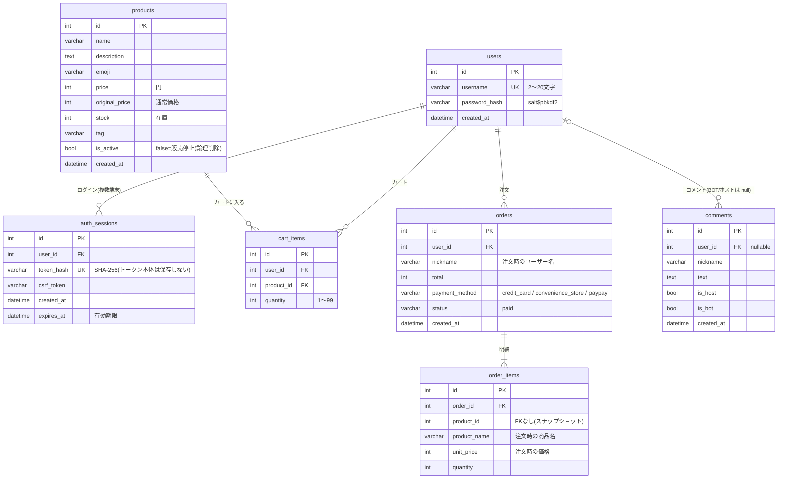

# ER 図

`app/models.py` と `migrations/versions/` の内容を図にしたもの。

## 設計のポイント
- **order_items は商品名・単価を「スナップショット」として保存**:注文後に商品の価格や名前が変わっても、過去の注文の金額は変わらない。
- **商品は物理削除せず is_active=false(論理削除)**:過去の注文から参照できなくなるのを防ぐ。
- **auth_sessions を users から分離**:1人が Web と iOS で同時にログインでき、端末ごとにログアウトできる。
